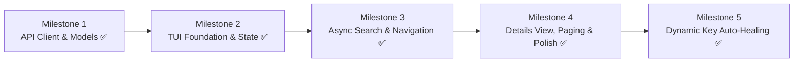

# Scoopfind Roadmap

`scoopfind` is a lightweight Terminal User Interface (TUI) package search and pager for [Scoop](https://scoop.sh) on Windows, powered directly by the official Scoop Azure AI Search API.

---

## Technical Stack & Architecture

- **Language:** Rust (2024 Edition)
- **TUI Framework:** `ratatui` (with `crossterm` backend)
- **Async Runtime & Networking:** `tokio` (multi-threaded runtime) + `reqwest` (JSON support, Windows native SChannel)
- **Serialization & Error Handling:** `serde`, `serde_json`, `anyhow`
- **Pattern Matching & Parsing:** `regex` (for dynamic key scraping)
- **Search Backend:** Scoop Search Azure API (`https://scoopsearch.search.windows.net/indexes/apps/docs/search?api-version=2020-06-30`)
- **Design Principles:**
  - **100% Online v1:** Directly queries the official Azure endpoint; no local bucket parsing or file indexing.
  - **Simple Rust ("Vibe-coding friendly"):** Avoid complex lifetimes (`'a`). Use owned types (`String`, `Vec`) and `.clone()` liberally to ensure straightforward state manipulation without borrow checker friction.
  - **Centralized State:** Single `App` struct holding search query, result list, selection index, UI mode, and async state.
  - **Self-Healing:** Automatically scrapes and refreshes the Azure Query Key from `scoop.sh` if the bundled key ever expires.

---

## Project Milestones

### Milestone 1: Project Setup, Data Models & Live API Client ✅
**Goal:** Configure dependencies, define owned data models, and verify live communication with the Scoop Azure Search API.

- [x] Initialize Cargo binary package (`cargo init`).
- [x] Add required dependencies (`ratatui`, `crossterm`, `tokio`, `reqwest`, `serde`, `serde_json`, `anyhow`, `regex`).
- [x] Define owned data structures in `src/models.rs`:
  - `ScoopPackage` (`id`, `name`, `version`, `description`, `homepage`, `license`, `metadata`, etc.)
  - `PackageMetadata` (`repository`, `official_repository`, `repository_stars`, `file_path`, etc.)
  - `AzureSearchResponse` (wraps Azure Search JSON array).
- [x] Implement `src/api.rs`:
  - Query endpoint: `https://scoopsearch.search.windows.net/indexes/apps/docs/search?api-version=2020-06-30`
  - Required headers: `api-key: DC6D2BBE65FC7313F2C52BBD2B0286ED`, `Content-Type: application/json`
  - POST payload with `search`, `top`, `skip`, and field selections.
- [x] Automated tests for model deserialization and live query smoke test.

---

### Milestone 2: Minimal TUI Shell & State Architecture ✅
**Goal:** Establish terminal alternate screen lifecycle and render an interactive search bar with static/mock data.

- [x] Configure `crossterm` terminal lifecycle (enter alternate screen, enable raw mode, panic hook for graceful terminal restoration).
- [x] Define the centralized `App` state in `src/app.rs`:
  - `query: String`
  - `results: Vec<ScoopPackage>`
  - `selected_index: usize`
  - `is_loading: bool`
  - `status_message: String`
  - `should_quit: bool`
- [x] Implement Ratatui layout in `src/ui.rs`:
  - **Header / Search Box:** Text input field with visual cursor.
  - **Results Area:** Vertical list placeholder.
  - **Footer:** Keybinding hints (`<Enter>` search, `<Up/Down>` select, `<Tab>` focus, `<Esc>` quit).
- [x] Implement key event loop in `src/main.rs`:
  - Typing characters updates `query`.
  - `<Backspace>` deletes characters.
  - `<Esc>` / `<Ctrl+C>` exits cleanly.

---

### Milestone 3: Asynchronous Search Integration & List Navigation ✅
**Goal:** Connect the live API client to the UI without blocking the render loop, enabling real-time navigation.

- [x] Set up asynchronous event communication:
  - Channel (`tokio::sync::mpsc`) to send search requests and receive results/errors back into `App`.
  - Non-blocking event polling using `crossterm::event::poll`.
- [x] Wire `<Enter>` key to dispatch Azure API requests.
- [x] Render dynamic results list using Ratatui `List`:
  - Columns / lines: Package Name, Version, Official Bucket badge, Star count.
- [x] Implement list selection navigation:
  - `<Up>` / `<Down>` (and `k` / `j`) to highlight packages with wrapping or bounds checking.
  - Update `selected_index` in `App`.

---

### Milestone 4: Package Detail Panel, Actions & Polish ✅
**Goal:** Deliver a complete, polished TUI pager with package metadata inspection and install command generation.

- [x] Add split pane for package details:
  - Description and usage notes.
  - Homepage URL and License.
  - Repository link and manifest path.
  - Ready-to-run install commands (`scoop bucket add <bucket>` and `scoop install <app>`).
- [x] Error handling & status banners:
  - Display friendly error alerts if offline or API returns an error.
  - Display empty state when no packages match the query.

---

### Milestone 5: Dynamic API Key Auto-Healing (Fallback Scraper) ✅
**Goal:** Self-heal gracefully if the default Azure Query Key is ever rotated or invalidated by Scoop maintainers.

- [x] Detect HTTP `401 Unauthorized` or `403 Forbidden` responses from Azure Search.
- [x] Implement automated fallback scraping flow in `src/api.rs`:
  1. Fetch `https://scoop.sh` HTML to discover the latest Vite script asset path (e.g. `/assets/index-[hash].js`).
  2. Fetch the discovered asset bundle.
  3. Extract the active `VITE_APP_AZURESEARCH_KEY` using regex (`VITE_APP_AZURESEARCH_KEY:\s*["'\`]([A-Fa-f0-9]{32})["'\``).
- [x] Update client state with the scraped key and automatically retry the original query.
- [x] Cache the dynamic key locally to avoid re-scraping on every launch.
- [x] Verified with unit test (`test_auto_heal_with_bad_key`) simulating an invalid key.
